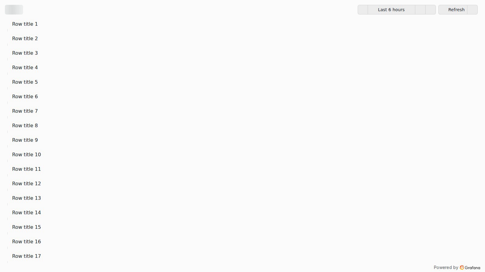
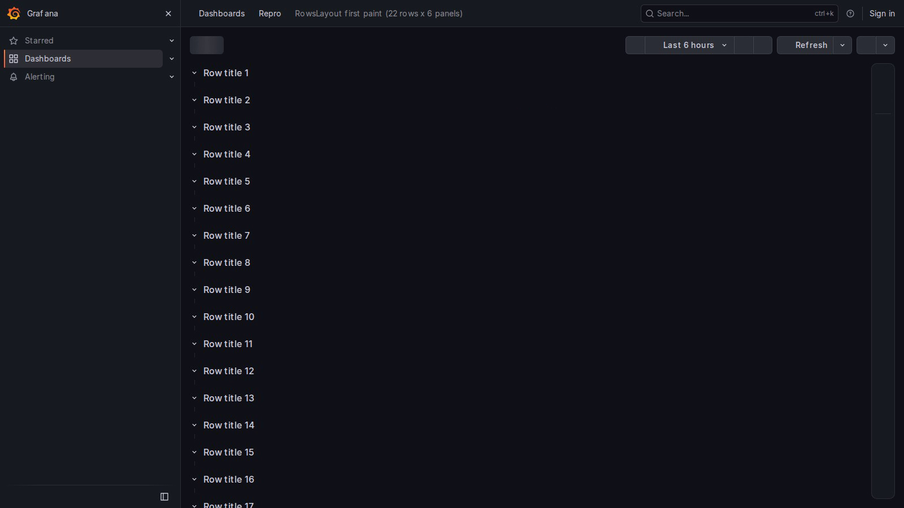

# Grafana: RowsLayout row titles are painted without their panels while a dashboard loads

Minimal reproduction for a first-paint issue in dashboards that use the v2 `RowsLayout`.
On load, Grafana first paints every row header with an empty (0 px) grid, so the page shows a bare list of
row titles. It then renders all grids and panels in one long task, and that frame stays on screen until it finishes.

Kiosk mode (`?kiosk`), Grafana 13.3.0, 4x CPU throttling. Kiosk renders row titles as plain text with no chevron,
so the page looks like a list of stray strings:



The same frame outside kiosk mode, where the row headers are recognizable:



Recordings (Grafana 13.3.0, 4x CPU throttling): [kiosk](docs/kiosk-load-cpu4x-13.3.0.webm),
[non-kiosk](docs/load-cpu4x-13.3.0-non-kiosk.webm).

## Run it

Requirements: Docker, Node.js 20+.

```bash
docker compose up -d                 # stock grafana/grafana:13.3.0, anonymous Viewer, TestData datasource
docker compose logs setup            # -> Imported: http://localhost:3000/d/rows-first-paint
npm install
npx playwright install chromium
npm run repro                        # 3 cold loads, checks every animation frame
npm run repro -- --cpu=4 --kiosk     # slower client (like a kiosk/TV), kiosk mode
npm run repro -- --kiosk --url='http://localhost:3000/d/rows-first-paint?theme=light'
npm run repro -- --video=videos      # also record the loads
```

Other Grafana versions / ports: `GRAFANA_IMAGE=grafana/grafana:13.1.0 GRAFANA_PORT=3001 docker compose up -d`
and `GRAFANA_PORT=3001 npm run repro`.

The dashboard (`dashboards/rows.json`) is generated by `node generate-dashboard.mjs [rows=22] [panelsPerRow=6]`.
It has 22 rows with 6 TestData panels each. The issue happens with any number of rows. With only a few rows the
frame is shorter, but it is still painted.

You can also check it by hand. Open http://localhost:3000/d/rows-first-paint in Chrome. In DevTools → Performance,
set CPU 4x slowdown and check "Disable cache" in Network. Then reload.

## Results

`repro.mjs` records, on every `requestAnimationFrame`, how many row headers are in the DOM and how many of them
already contain their `.react-grid-layout`. A run fails if a frame has row headers but no grids.

| Grafana | CPU | Row titles painted without any panels |
| --- | --- | --- |
| 13.3.0 (stock image) | 1x | 3/3 runs, 0.6–1.0 s |
| 13.3.0 (stock image) | 4x | 2/2 runs, ~4 s |
| 13.1.0 (stock image) | 1x | 2/2 runs, 0.7–1.3 s |
| 13.1.0 built from source **with the proposed fix** | 1x / 4x | 0/3 and 0/2 runs |

## Root cause

- In a v2 `RowsLayout`, each row renders its header (`RowItemRenderer`) and its own `SceneGridLayout`.
- `SceneGridLayoutRenderer` in `@grafana/scenes` gets the grid width from react-use `useMeasure`. That hook reports
  the size only from a `ResizeObserver` callback, so on mount `width` is `0` and `renderGrid()` returns `null`.
- The `ResizeObserver` notification causes a normal React update, which is not applied before the browser paints.
  So the browser first paints all row headers with empty grids.
- Then, in a single long task, all grids and panels are rendered (~0.6 s for 132 panels on a desktop CPU, several
  seconds on slower clients). The row-titles-only frame stays visible for that whole task.
- In kiosk mode, row titles are rendered as plain text with no chevron, and navigation is hidden. The frame is a bare
  list of strings, and viewers can't tell they are row titles.
- Classic dashboards are not affected in the same way. Their rows are items inside the one grid, so nothing is
  painted before that grid is measured.

## Proposed fix

Measure the grid wrapper synchronously in `useLayoutEffect`. React applies state updates from layout effects
before the browser paints, so row headers and their grids are painted in the same frame. Keep a
`ResizeObserver` for later size changes, and ignore updates that do not change the size.

- [`proposed-fix/scenes-SceneGridLayoutRenderer.diff`](proposed-fix/scenes-SceneGridLayoutRenderer.diff): change to
  `grafana/scenes` `main` (558ee11). It adds a `useMeasureBeforePaint` hook (`grid/useMeasureBeforePaint.ts` + unit
  tests), uses it in `SceneGridLayoutRenderer`, and updates the existing grid test mock. `tsc`, `eslint`, `prettier`
  and the whole `packages/scenes` jest suite pass (88 suites, 1987 tests).
- [`proposed-fix/grafana-v13.1.0-yarn-patch.diff`](proposed-fix/grafana-v13.1.0-yarn-patch.diff): the same logic as a
  yarn patch of `@grafana/scenes@8.2.6` for Grafana `v13.1.0` (`.yarn/patches` + `resolutions`), the same mechanism
  Grafana already uses for `react-grid-layout`. This is the variant that was built into Grafana and tested in the
  browser (table above). With it, panel geometry was identical to the unpatched build for load, window resize, row
  collapse/expand and view panel, and time to panels did not get worse.
